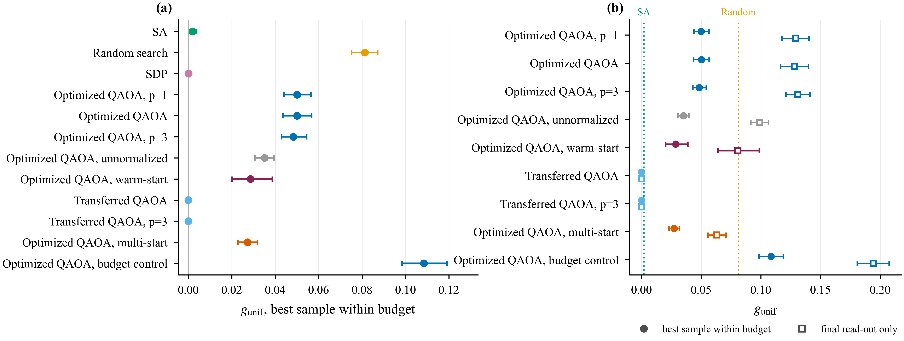
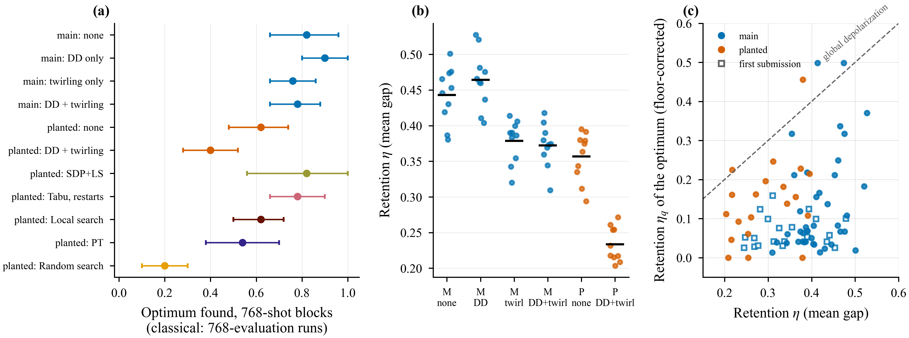

<div align="center">

# When Does QAOA Help Inside ADMM?

### A matched-budget benchmark of scoring rules, angle transfer, and hardware noise

[](LICENSE)
[](https://creativecommons.org/licenses/by/4.0/)
[](https://www.ibm.com/quantum/qiskit)
[](#-hardware-records)
[](https://nbviewer.org/github/sanim-yousuf/qaoa-admm-benchmark/blob/main/notebook/quantum-experiment-V11.ipynb)

**Mohammad Arif Hossain . Sanim Yousuf Fahim**

Code, cached results, test log, and raw quantum-hardware records for the article<br>
*"When Does QAOA Help Inside ADMM? A Matched-Budget Benchmark of Scoring Rules, Angle Transfer, and Hardware Noise"*<br>
submitted to *IEEE Transactions on Quantum Engineering*.

[Key findings](#-key-findings) ·
[Quick start](#-quick-start) ·
[Where each result lives](#-where-each-result-lives) ·
[Extended results](#-extended-results) ·
[Reproducibility](#-how-the-results-were-produced) ·
[Hardware records](#-hardware-records)

</div>

---

> [!NOTE]
> Every number, table, and figure in the article is computed by the notebook in this repository from the files in [`results/`](results/). Nothing in the article is entered by hand, and every result file carries a SHA-256 checksum in [`PROVENANCE_MANIFEST.csv`](PROVENANCE_MANIFEST.csv).

## 🔭 Overview

The **alternating direction method of multipliers (ADMM)** splits a mixed-binary optimization problem into a continuous part and a binary part. The binary part is a quadratic unconstrained binary optimization (QUBO) problem, and it has been proposed to solve it with the **quantum approximate optimization algorithm (QAOA)**.

This benchmark asks a simple question: **does QAOA help inside ADMM when every solver receives exactly the same budget of objective evaluations?**

<table>
<tr>
<td width="50%" valign="top">

**Solvers compared**

- QAOA with per-instance optimized angles
- QAOA with transferred (pre-trained) angles
- Random search
- Simulated annealing (default and tuned)
- Tabu search (single trajectory and with restarts)
- Local search and parallel tempering
- SDP rounding, with and without local search

</td>
<td width="50%" valign="top">

**What is tested**

- Two scoring rules: best sample vs. final read-out
- A main family and a rugged Wishart planted family
- A penalty sweep, explained by a theorem
- A fixed budget up to 24 variables
- Time to solution up to 20 variables
- Two families that do not reduce to a QUBO
- 12-qubit runs on IBM Quantum hardware

</td>
</tr>
</table>

Before any experiment runs, a **correctness gate** checks the cost Hamiltonian at the matrix, circuit, and sampling levels. All **417 hypothesis tests** are recorded in a test log with family-wise corrections.

## 🎯 Key findings

| | Finding |
|:---:|---|
| **1** | **The scoring rule decides the comparison.** With 23 optimizer evaluations per subproblem, optimized QAOA *loses* to random search when scored on its final read-out and *wins* when credited with its best sample, on the same runs (at $n=12$, 16, and 20; marginally at 20). |
| **2** | **Transferred angles work, but the advantage is narrow.** In noiseless 12-qubit simulation, depth-2 transferred-angle QAOA solves **97.3%** of planted-family subproblems exactly, against **50.6%–67.4%** for the four strongest local heuristics; SDP rounding with local search reaches a statistically indistinguishable **96.5%**. Its time to solution is three to five times smaller than the local heuristics' (under the evaluation-counting convention), but grows with a larger exponent, is about ten times that of SDP rounding with local search, and is 54 times that of tabu search with restarts in seconds. |
| **3** | **The penalty decides what ADMM's binary step solves.** The binary step is a proximal step on the reduced QUBO: at unit penalty ADMM re-solves it, and at larger penalties exact subproblem solutions increasingly stall. A noisy solver's ADMM-level advantage at penalty 2 is an artifact of the penalty. |
| **4** | **No problem family gave QAOA a better ADMM outcome** than the best classical choice of solver and penalty. |
| **5** | **Hardware keeps the mean gap but loses the optimum.** On `ibm_marrakesh`, transferred-angle circuits retained medians of **29%–46%** of their mean-gap improvement but only **5%–15%** of their probability of the optimum. Mean-gap validation overstates the fidelity that matters for time to solution. |

<p align="center">
  <br>
  <sub><b>The scoring rule decides the comparison.</b> Each QAOA protocol under best-sample (filled) and final-read-out (open) scoring, against simulated annealing and random search (article, Fig. 2).</sub>
</p>

<p align="center">
  <br>
  <sub><b>Hardware at n = 12.</b> Optimum found per suppression mode, mean-gap retention per instance, and floor-corrected retention of the probability of the optimum against mean-gap retention (article, Fig. 9).</sub>
</p>

## 📁 Repository structure

```
qaoa-admm-benchmark/
├── README.md
├── EXTENDED_RESULTS.md             Results the article summarizes without tabulating in full
├── LICENSE                         MIT license for the code
├── PROVENANCE_MANIFEST.csv         Notebook version and SHA-256 checksum of every result file
├── requirements.txt                Pinned Qiskit versions and the other packages used
├── notebook/
│   └── quantum-experiment-V11.ipynb    Final executed notebook — the run the article reports
├── provenance/
│   └── quantum-experiment-V6.0 … V10.ipynb   Earlier executed versions that computed the cached results
└── results/
    ├── *.csv, *.json               Per-instance results, test log, tuned configurations, timings,
    │                               hardware counts, and post hoc analyses (162 files)
    └── figures/                    Every figure produced by the notebook (PDF and PNG)
```

> [!TIP]
> File names in `results/` start with an **experiment code** (`S10`, `R27`, `E41`, …) that identifies the notebook section that produced them. Files ending in `__keys.json` are cache indexes.

## 🚀 Quick start

No IBM Quantum account or token is needed for any of the three options below.

<table>
<tr>
<th width="33%">① Inspect</th>
<th width="33%">② Regenerate from results</th>
<th width="33%">③ Recompute from scratch</th>
</tr>
<tr>
<td valign="top">

Open [`notebook/quantum-experiment-V11.ipynb`](notebook/quantum-experiment-V11.ipynb) or [view it on nbviewer](https://nbviewer.org/github/sanim-yousuf/qaoa-admm-benchmark/blob/main/notebook/quantum-experiment-V11.ipynb). Every printed table, test, and figure is the stored output of the reported run.

**Time:** none

</td>
<td valign="top">

Keep `RESUME = True` and run all cells with the files of `results/` in the notebook's working directory (on Kaggle, attach `results/` as an input dataset). The notebook reloads every cached result and regenerates all tables, tests, the test log, figures, and the post hoc analyses.

**Time:** minutes

</td>
<td valign="top">

Set `RESUME = False` and keep only the hardware records. Every simulation is recomputed; hardware counts are always reused.

**Time:** many hours

</td>
</tr>
</table>

```bash
git clone https://github.com/sanim-yousuf/qaoa-admm-benchmark.git
cd qaoa-admm-benchmark
python -m venv .venv && source .venv/bin/activate
pip install -r requirements.txt jupyter
cp results/*.csv results/*.json notebook/    # the notebook reads cached results from its working directory
jupyter lab notebook/quantum-experiment-V11.ipynb
```

> [!IMPORTANT]
> In option ③, quantities whose floating-point path depends on the machine (the SCS solution of the SDP relaxation and the SDP-based solver outputs) and all wall-clock timings may differ from the released files. These differences have not been measured on a second machine.

## 🗺️ Where each result lives

| Article item | Content | Result files |
|---|---|---|
| Fig. 2, Table 10 | Main ADMM-embedded comparison | `S10_*` |
| Table 2 | Scoring rules with independent draws | `RV1_scoring_replicate.csv`, `R27_*`, `R26_*` |
| Table 3 | Stronger classical baselines and cost | `R25_*` |
| Fig. 3 | Accuracy on identical subproblems | `H35_*`, `E37_*` |
| Fig. 4, Table 12 | Fixed budget, $n=12$ to 24 | `R26_*` |
| Tables 4, 13; Fig. 12 | Planted family, near-degenerate competitors, landscape | `H31_*`, `H32_*`, `H33_*`, `E37_*`, `RV2_*` |
| Tables 5, 6, 14; Fig. 5 | Time to solution, exponents, timings | `E39_*` |
| Fig. 6 | Penalty sweep and stalling checks | `R27_*` |
| Fig. 7 | ADMM against a direct solution of the reduced QUBO | `H34_*`, `E37_*` |
| Fig. 8 | Mixed-binary families that do not reduce to a QUBO | `R28_*`, `E43_*` |
| Tables 7, 8; Fig. 9 | Hardware at $n=12$ and retention analysis | `R29_*`, `E40_*`, `E41_*`, `RV3_*` |
| Table 11 | Transferred angles by training size | `S10a_*`, `S10b_*` |
| Fig. 11 | Size, SDP extension, noise, and budget sweeps | `S14_*`, `S14b_*`, `S15_*`, `S16_*` |
| Correctness gate | Matrix, circuit, and sampling checks | `S0_correctness_gate.csv` |
| Test log | All 417 hypothesis tests with Holm families | `S25_test_registry.csv` |
| [`EXTENDED_RESULTS.md`](EXTENDED_RESULTS.md) | Tuning grids, run budgets, $n=8$ hardware, hardware-driven ADMM, mechanism studies | `E36_*`, `H37_*`, `E39_tts_budget_choice.csv`, `S22_*`, `R29_hw_admm_*`, `E42_*`, `S12_*`, `S13_*`, `S21_*` |

## 📑 Extended results

The appendices of the article summarize a few results in a sentence or two. [`EXTENDED_RESULTS.md`](EXTENDED_RESULTS.md) gives them in full, unchanged from the notebook outputs, with the result files each one comes from.

| Section | Contents | Article |
|:---:|---|---|
| **A1** | Tuning grids and selected configurations of the classical solvers | Appendix G |
| **A2** | Run budgets of the time-to-solution study, per solver, size, and family | Section VII-F, Appendix G |
| **A3** | Hardware validation at $n=8$: full study, with the gap and total variation distance of every condition | Section VII-I, Appendix H |
| **A4** | Hardware-driven ADMM runs on the main and planted families | Appendix H |
| **A5** | Mechanism studies of per-instance angle optimization: optimizers, depth, multi-start, and landscape mitigations | Appendix D |

## 🧪 How the results were produced

The notebook caches every per-instance result. A later execution given the earlier outputs (`RESUME = True`) reloads them unchanged and runs only the experiments that are missing, so the experiments accumulated over successive versions of the notebook, all executed on Kaggle.

<details>
<summary><b>Version history (V6.0 → V11)</b></summary>
<br>

| Version (date) | Results first computed in this version |
|---|---|
| V6.0 and V6.1 (29 Sep 2026) | Main comparison, transfer, mechanism and ablation, size, budget, noise, MaxCut, density, SA sensitivity, Hamiltonian defect, landscape mitigations (S10–S21); $n=8$ hardware (S22). Both are complete executions from scratch, and their simulated results agree bit for bit (wall-clock timings aside). The transfer from $n=6$ and 8 (S10b) was added in V6.1 and computed only there. |
| V7.0 (30 Sep 2026) | Stronger baselines, fixed budget, penalty sweep, general family, first $n=12$ hardware submission, cost (R25–R30) |
| V8 (1 Oct 2026) | Planted family, landscape diagnostics, direct QUBO, shared trajectory, first time-to-solution study (H31–H37) |
| V9 (1 Oct 2026) | Angles retrained at $n=16$, second $n=12$ hardware submission, hardware-driven ADMM (E38, E41, E42) |
| V10 (2 Oct 2026) | Tuning on extended grids, stronger heuristics, time to solution with held-out budgets and timings, hardware uncertainty analysis, general family with planted couplings, test log (E36–E43, S25) |
| V11 (Oct 2026) | No new experiments. Section 50: post hoc analyses computed from the cached results (RV1–RV5) |

</details>

The final execution (V11) reproduced every printed table and test of V10 unchanged, including the shot-sampled $n=8$ noisy simulation, which is recomputed at each execution. Code changes made after a result was cached only added options whose defaults leave that result unchanged. All random number generators are seeded.

<details>
<summary><b>Post hoc analyses (notebook Section 50)</b></summary>
<br>

Section 50 reuses the notebook's own functions and the cached results. It runs no new experiments and submits no hardware jobs; only 50.3 and 50.4 re-execute recorded computations. None of these analyses is part of the test log.

| Subsection | Output | Contents |
|---|---|---|
| 50.1 | `RV1_scoring_replicate.csv` | Scoring rules with the circuit sampler and with independent draws, at every penalty and at $n=16$ and 20 (Table 2) |
| 50.2 | `RV2_planted_complement_*.csv` | Planted family re-scored with criteria that credit near-degenerate competitors (Table 13) |
| 50.3 | `RV3_hw_threshold_retention.csv` | Threshold- and Hamming-resolved hardware retention, and the re-executed device-matched simulation of the first $n=12$ submission, which reproduces its recorded retention exactly (Table 8). Set `RV_DEVICE_SIM = False` to skip the re-execution (about one hour). |
| 50.4 | `RV4_readout_replay.csv` | Check of the circuit sampler's shared random stream |
| 50.5 | `RV5_angle_symmetry.csv` | Distance between the planted-family angle sets up to the symmetries of the QAOA output |
| 50.6 | printed | Time-to-solution ratios and checks quoted in the article |

</details>

## ⚠️ Known limitation: the circuit sampler's shared random stream

> [!WARNING]
> In `run_qaoa` with `sim="qiskit"`, one Qiskit Aer `SamplerV2(seed=...)` is created per subproblem and called once per optimizer evaluation, for the read-out, and for the top-up. The Aer sampler restarts its seeded stream at every call, so identical angles return identical shots and the read-out at the returned angles repeats the optimizer evaluation there.

| | |
|---|---|
| **Affected** | Optimized QAOA in the experiments drawn with the circuit sampler (S10–S21; Table 9 of the article, column "Sampler") |
| **Unaffected** | Transferred-angle QAOA (one call per subproblem), every experiment with `sim="fast"` (R25–R28, H31–H37, E36–E43), and all hardware runs |
| **Replicate** | The penalty sweep (R27) repeats the main optimized-QAOA arm on the same instances with independent draws; Section 50.1 compares the two (`RV1_scoring_replicate.csv`; Appendix C of the article) |
| **Fix for reuse** | Pass a fresh seed to every call, e.g. `seeded_sampler(seed * 1000 + call_index)`, or use `sim="fast"` |

## ⚛️ Hardware records

Raw counts, circuits (QASM), job identifiers, calibration time, and readout calibration are released for every IBM Quantum job.

| File | Contents |
|---|---|
| `S22_hardware_counts.json` | $n=8$ validation study (two sessions) |
| `R29_hardware_n12.json` | First $n=12$ submission |
| `E41_hardware.json` | Second $n=12$ submission: suppression modes and planted-family circuits |
| `R29_hw_admm_*`, `E42_hw_admm_*` | Hardware-driven ADMM runs |

> [!CAUTION]
> The notebook submits jobs only if the corresponding records are missing **and** an IBM Quantum token is present. To submit jobs, provide the token through the `IBM_QUANTUM_TOKEN` environment variable or a Kaggle secret. Never write it into the notebook or commit it to the repository.

## 🧰 Software environment

| Component | Version |
|---|---|
| Qiskit | 2.5.2 (pinned) |
| Qiskit Aer | 0.17.2 (pinned) |
| Qiskit IBM Runtime | 0.49.0 (pinned) |
| NumPy, SciPy, CVXPY (SCS), NetworkX, pandas, matplotlib | Versions of the Kaggle Python image at each execution (not recorded) |
| Hardware | IBM Quantum `ibm_marrakesh` (156 qubits), via Qiskit Runtime |

## 📜 License

| Part | License |
|---|---|
| Code (the notebooks) | [MIT License](LICENSE) |
| Data (everything in `results/`, including the hardware records) | [Creative Commons Attribution 4.0 International (CC BY 4.0)](https://creativecommons.org/licenses/by/4.0/) |

## ✉️ Contact

**Mohammad Arif Hossain** (corresponding author)<br>
Department of Engineering Technology, Middle Tennessee State University, Murfreesboro, TN, USA<br>
📧 mohammad.hossain@mtsu.edu

Questions, bug reports, and reproductions on other machines are welcome through [GitHub issues](https://github.com/sanim-yousuf/qaoa-admm-benchmark/issues).

## 🙏 Acknowledgment

We acknowledge the use of IBM Quantum services for this work. The views expressed are those of the authors and do not reflect the official policy or position of IBM or the IBM Quantum team.
